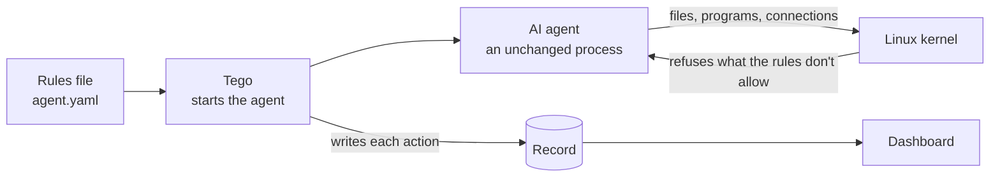

<h1 align="center">
  <picture>
    <source media="(prefers-color-scheme: dark)" srcset="docs/assets/tego-logo-dark.svg">
    <source media="(prefers-color-scheme: light)" srcset="docs/assets/tego-logo.svg">
    
  </picture>
</h1>

<p align="center"><strong>Rules your AI agent can't ignore.</strong></p>

<p align="center">
  <a href="LICENSE"></a>
  <a href="https://attention-span.ai/docs/supported-systems/"></a>
  <a href="docs/CHANGELOG.md"></a>
</p>

<p align="center">
  <a href="https://attention-span.ai/docs/getting-started/">Quickstart</a> &nbsp;·&nbsp;
  <a href="https://attention-span.ai/docs/">Docs</a> &nbsp;·&nbsp;
  <a href="https://attention-span.ai/docs/security-and-limits/">Limits</a> &nbsp;·&nbsp;
  <a href="CONTRIBUTING.md">Contributing</a>
</p>

Tego runs an AI agent under a rules file: a short YAML file that lists the files, programs and network hosts the agent
may use. The Linux kernel enforces those rules from outside the agent, so an agent that is wrong or prompt-injected
can't talk its way past them. Every session leaves a record of what the agent did and what Tego refused, and you can
check that nobody changed it.

Tego works with any agent that runs as a process: Claude Code, Codex, an MCP server, a Python script or your own agent.
It never calls an AI model itself.

<p align="center">
  <picture>
    <source media="(prefers-color-scheme: dark)" srcset="docs/assets/dashboard-overview-dark.png">
    <source media="(prefers-color-scheme: light)" srcset="docs/assets/dashboard-overview-light.png">
    
  </picture>
</p>

## Try it

Install on Linux or macOS:

```sh
curl -fsSL https://github.com/Attention-Span-AI/Tego/releases/latest/download/install.sh | sh
```

On Windows, in PowerShell:

```powershell
irm https://github.com/Attention-Span-AI/Tego/releases/latest/download/install.ps1 | iex
```

On macOS and Windows, Tego runs in a small Linux virtual machine that the installer sets up.
[Install](https://attention-span.ai/docs/install/) covers each system, updates and building from source.

Set up your first agent and project, then run it:

```sh
tego start
cd ~/tego-sample && tego run tego-sample
```

`tego start` asks four questions: which agent, how it logs in, which project, and which rules. The sample project has a
dependency that tries to read the project's `.env` file and send it out. Ask the agent to run the tests: they pass, and
Tego refuses both actions.

```text
  ✓ Session tego-sample-6hbm ended · 2 actions refused
      Details: tego session show tego-sample-6hbm
```

`tego dashboard` shows the same session in your browser. The [Quickstart](https://attention-span.ai/docs/getting-started/)
walks through each step.

## How it works



1. Tego reads the rules file and starts the agent inside the limits it sets.
2. The kernel checks each file, program and connection the agent uses. An action the rules don't allow fails with an
   ordinary permission error; the agent doesn't have to cooperate.
3. Each action goes into the session's record. `tego session show` and the dashboard read it.

[How Tego works](https://attention-span.ai/docs/concepts/) explains the model, and
[Protection levels](https://attention-span.ai/docs/tiers/) explains what each machine can enforce.

## A rules file

```yaml
version: 0
name: my-agent
command: ["claude", "-p", "Fix the failing test"]
extends: tego/no-secrets
fs:
  write: ["./src/", "./tests/"]
exec:
  allow: ["bash", "git", "python3"]
net:
  allow: ["api.anthropic.com:443"]
```

This agent can write only in `src/` and `tests/`, run only `bash`, `git` and `python3`, and connect only to
Anthropic's API. The `tego/no-secrets` preset keeps your secret files and variables away from it. Create one with
`tego rules create` and check it with `tego rules check`. [Rules file fields](https://attention-span.ai/docs/rules-reference/)
lists every field.

## Limits

- An allowed program can do anything that program can do. If `python3` is allowed, so is everything Python can do.
- Every allowed host is a way out for data. Rules match a host and port, not what is sent there.
- Tego limits only what the rules file names. With no `net:` section, every host is reachable; with no `exec:` section,
  every program runs.
- The agent can't change its session's record without the change showing. The person who started the session can.

[Security and limits](https://attention-span.ai/docs/security-and-limits/) lists the rest, with what to do about each.

## Documentation

[Get started](https://attention-span.ai/docs/getting-started/) ·
[Core concepts](https://attention-span.ai/docs/concepts/) ·
[Agents](https://attention-span.ai/docs/claude-code/) ·
[Advanced usage](https://attention-span.ai/docs/testing-rules/) ·
[Production](https://attention-span.ai/docs/servers-and-ci-runners/) ·
[Reference](https://attention-span.ai/docs/commands/)

The user docs are written in [docs/site/](docs/site/) and published at attention-span.ai/docs. Contributor docs
(architecture, specifications, decision records) start at [docs/README.md](docs/README.md).

## Contributing, security, license

- **Contributing:** [CONTRIBUTING.md](CONTRIBUTING.md) explains how to build, test and send a change. Everyone taking part
  follows the [Code of Conduct](CODE_OF_CONDUCT.md).
- **Security:** report a vulnerability privately, as [SECURITY.md](SECURITY.md) describes, not in a public issue.
- **License:** [Apache-2.0](LICENSE). The kernel programs in `bpf/` are dual licensed
  [GPL-2.0-only or BSD-2-Clause](LICENSES/README.md). [Third-party notices](THIRD_PARTY_NOTICES.txt) cover the
  dependencies.

Claude, Codex and other product names are trademarks of their owners. Tego is not affiliated with or endorsed by them.
Tego is made by [Attention Span](https://attention-span.ai).
