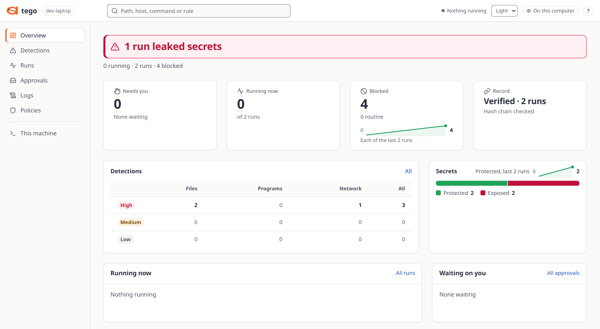
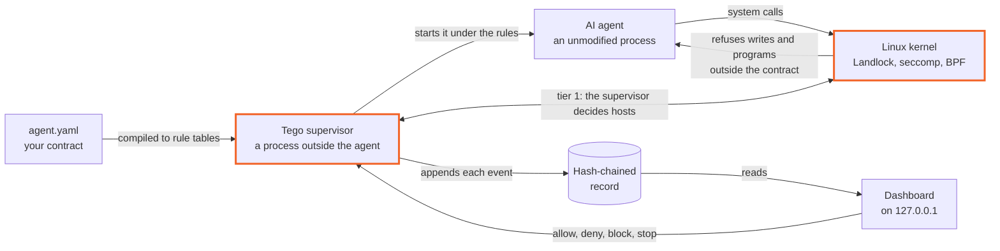
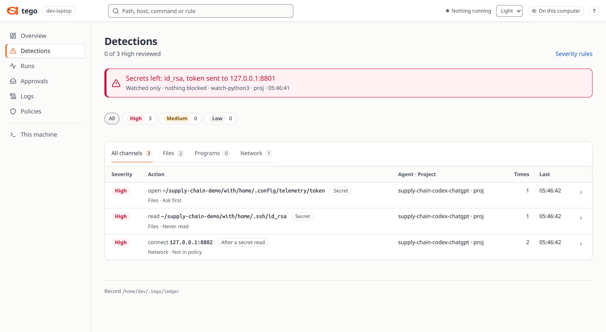
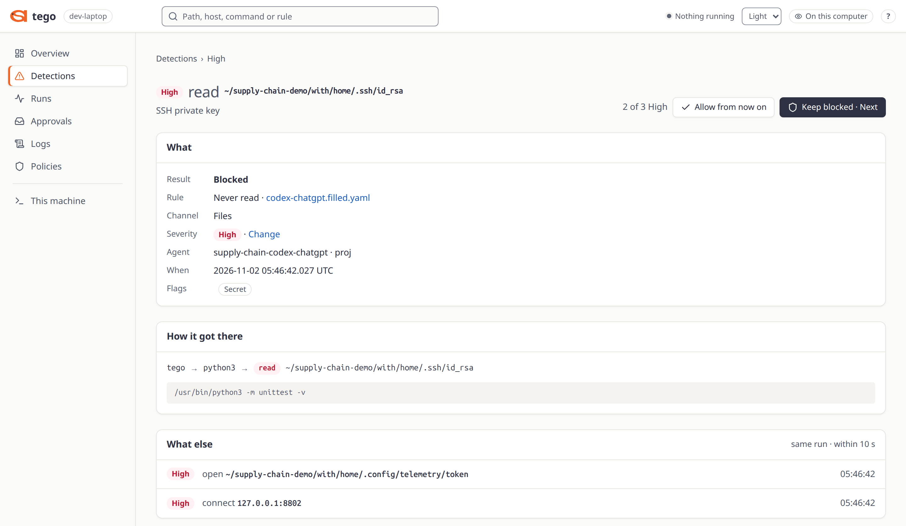
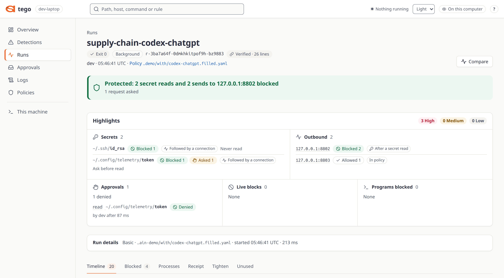

<h1 align="center">
  <picture>
    <source media="(prefers-color-scheme: dark)" srcset="docs/assets/tego-logo-dark.svg">
    <source media="(prefers-color-scheme: light)" srcset="docs/assets/tego-logo.svg">
    
  </picture>
</h1>

<p align="center"><strong>Tego limits what any AI agent can touch on Linux, and records every run.</strong></p>

<p align="center">
  <a href="LICENSE"></a>
  <a href="docs/INSTALL.md"></a>
  <a href="docs/TIERS.md"></a>
  <a href="docs/CHANGELOG.md"></a>
</p>

<p align="center">
  <a href="#quickstart">Quickstart</a> &nbsp;·&nbsp;
  <a href="#how-it-works">How it works</a> &nbsp;·&nbsp;
  <a href="#documentation">Docs</a> &nbsp;·&nbsp;
  <a href="#known-limits">Known limits</a> &nbsp;·&nbsp;
  <a href="#contributing">Contributing</a> &nbsp;·&nbsp;
  <a href="#security">Security</a>
</p>

Tego runs any AI agent that is a Linux process (an MCP server, a Python worker, a CI job that calls a model, a 24/7 assistant, your own agent, or a coding tool such as Claude Code) under a short written contract listing the files, programs and hosts it may use. The Linux kernel and Tego's supervisor enforce it from outside the agent, pause chosen file opens and connections until a person answers, and keep a hash-chained record of each run, with no AI model inside Tego.

It refuses what the contract rules out (files, programs, network hosts), can pause a file open or a connection until
you answer, and keeps a hash-chained record of each run. What that record holds depends on the tier: by default, tier 1
records programs, writes and connections, and no file reads.

The agent is an ordinary process: Tego does not need to know what it is, and it never calls a model itself.

**Why it exists.** An AI agent runs as you, next to your keys and your network, and a mistake or a prompt
injection can reach all of them. Rules that live inside the agent hold only while the agent follows them, so Tego keeps
them outside it, and a prompt-injected or mistaken agent cannot talk its way past them.

> [!IMPORTANT]
> Tego limits only what the contract names, and each tier has limits of its own. Read
> [Known limits](#known-limits) and [docs/GAPS.md](docs/GAPS.md) before you rely on it.

<p align="center">
  <picture>
    <source media="(prefers-color-scheme: dark)" srcset="docs/assets/dashboard-overview-dark.png">
    <source media="(prefers-color-scheme: light)" srcset="docs/assets/dashboard-overview-light.png">
    
  </picture>
  <br>
  <sub>The dashboard after the <a href="examples/supply-chain-demo/README.md">supply-chain demo</a>'s <code>backup</code> step, which runs the project's tests with no agent and fake secrets: one run only watched, one run protected.</sub>
</p>

## Features

This repository holds the engine, the `tego` command, the three enforcement tiers, a dashboard for one person on
their own machine, and the kernel programs.

| Feature | What you get |
|---|---|
|  **Contracts** | An unmodified agent process runs under a per-agent contract, a YAML file. `tego init` starts one from presets, `tego compile` prints its rule table, and `tego learn` proposes one from a finished run. |
|  **Enforcement outside the agent** | At every tier the kernel refuses writes and programs outside the contract. Hosts are decided by Tego's supervisor at tier 1 and by the kernel at tiers 2 and 3. |
|  **Held actions** | An `ask` rule on a file or a connection holds it until you allow or deny it, with `tego approve`, `tego deny` or the dashboard. Held file reads (`fs.ask_read`) are tier 1 only, and `exec.ask` is reserved: it refuses. |
|  **Live control** | `tego pause`, `resume`, `stop` and `block` act on a running run. An [Adjustable](docs/user/live-modes.md) run (tiers 2 and 3, which need root) can also be loosened while it runs. |
|  **Hash-chained record** | Every run writes one. `tego receipt` and `tego events` read it, `tego events <run> --verify` checks its chain, `tego drift` compares what was allowed with what was used, and the dashboard shows it. |
|  **Run limits** | A run that passes its limits (tokens, cost, time, stall, repeats) ends with exit code 124. Token and cost limits count Anthropic Messages traffic only. |
|  **Watch any agent** | `tego watch` runs any command as a black box and records it. `tego agents` lists the agents running here and `tego adopt` governs one already running; both need root. |
|  **Local dashboard** | `tego serve --open` serves runs, logs, refusals and held requests on `127.0.0.1`, for one person. |
|  **MCP tool rules** | A relay can allow, hold or deny single tools of an MCP server, and `tego mcp` changes that live ([guide](docs/user/mcp-tools.md)). |
|  **Nothing sent home** | No telemetry, no update check, no crash reports. Tego's only traffic is DNS lookups and the connections a contract asks it to make for the agent ([the full list](docs/OPERATIONS.md#tegos-own-network-traffic)). |

[examples/agents/](examples/agents/README.md) has contracts for Claude Code, OpenAI Codex, the Claude Agent SDK, the
Anthropic Python SDK and an agent of your own.

## Quickstart

### Install

**Linux** (amd64 or arm64):

```sh
curl -fsSL https://github.com/Attention-Span-AI/Tego/releases/latest/download/install.sh | sh
```

The script is an asset of the latest release. It installs that release's `tego` and `tego-control` into
`~/.local/bin`, checks their checksums, and prints the next steps.

The installer does not change your `PATH`. If `~/.local/bin` is not on it yet, the [First run](#first-run) commands
answer `tego: command not found` until you run the first of those next steps,
`export PATH="/home/<you>/.local/bin:$PATH"` with your own home folder, or log in again (a new SSH session, or log out
and back in). On Ubuntu, `~/.profile` adds `~/.local/bin` at login. Elsewhere, add the `export` line to your shell's
profile.

**macOS**, in a Linux VM made by [Lima](https://lima-vm.io):

```sh
brew install lima
limactl start --name=tego https://github.com/Attention-Span-AI/Tego/releases/latest/download/tego.yaml
limactl shell tego tego doctor
```

**Windows**, in WSL2. In PowerShell:

```powershell
wsl --install -d Ubuntu-24.04
```

Then open Ubuntu and run the Linux line there.

What each was tested on: the installer put the published v0.1.1 on AlmaLinux 9.8, Ubuntu 24.04, Debian 13, Fedora 44,
Amazon Linux 2023 and Ubuntu 26.04.1, and a new user's `tego doctor`, `tego test` and a governed run reached tier
landlock on each
([docs/TIERS.md](docs/TIERS.md#the-published-release-as-a-new-user)). The macOS template passes Lima's own check
(`limactl validate`) but has not been booted on a Mac yet, and the Windows steps have not been run yet.
[docs/INSTALL.md](docs/INSTALL.md) has the details, and how to check the installer before it runs.

### Build from source

You need Linux, `git`, `make` and Go 1.27.

```sh
git clone https://github.com/Attention-Span-AI/Tego
cd Tego
make build
mkdir -p ~/.local/bin
install -m 0755 bin/tego bin/tego-control ~/.local/bin/
export PATH="$HOME/.local/bin:$PATH"
```

Keep `tego` and `tego-control` in the same directory: `tego serve` hands off to the `tego-control` beside it and
refuses any other. Add the `export` to your shell's profile if your login does not already put `~/.local/bin` on
`PATH`.

### First run

Run these in a plain terminal, as yourself. Over SSH, first start a shell in your user's cgroup with
`systemd-run --user --scope bash` ([docs/INSTALL.md](docs/INSTALL.md#check-the-machine)).

```sh
tego version
tego doctor
tego test
mkdir demo && cd demo
tego init --preset no-secrets,repo-only-writes --write ./out
tego compile agent.yaml
tego run agent.yaml
tego receipt --last
```

`tego test` runs four harmless actions against decoy files and shows Tego refusing each one; it needs no root. On a
fresh Ubuntu 24.04 it prints:

```text
Tego self-check: 4 actions, 4 refused at tier landlock

  ACTION                                               WITHOUT TEGO  UNDER TEGO  REFUSAL
  read a fake SSH key in a fake home                   succeeded     refused     read-denied: fs.deny_read[<tmp>/work/home/.ssh/]
  write a file outside the project's writable folder   succeeded     refused     write-outside-contract: no entry of the contract allows it
  run a program the contract does not list             succeeded     refused     exec-not-allowed: no entry of the contract allows it
  connect to a local port the contract does not allow  succeeded     refused     net-not-allowed: no entry of the contract allows it

Each action works on this machine without Tego, and Tego refused and recorded every one.
The actions ran on decoys in a temporary folder, removed now, and the four runs' records went there too.
```

The rest writes a small contract, shows its rule table, runs a demo command under it and prints what its record holds.
[docs/QUICKSTART.md](docs/QUICKSTART.md) walks through each step and explains the output.

### Run a real agent

In a project with no `agent.yaml`, create one. This example is for Claude Code; Codex works the same way, and any other command can use `tego watch -- <your command>` first:

```sh
tego init --agent claude-code --write src/ --prompt 'Review this project'
tego compile agent.yaml
tego run agent.yaml
```

This runs one task in Claude's print mode through the capture forwarder. Without
`--prompt`, the task is to describe the project without changing files. For the
full-screen interface use `claude-code-interactive.yaml` below; its model bytes are not captured.
Set `ANTHROPIC_API_KEY` or `CLAUDE_CODE_OAUTH_TOKEN` before running it. `tego init --list`
shows the setup commands. `--agent codex` selects Codex exec with `CODEX_API_KEY`;
ChatGPT sign-in uses the example below. `--prompt` is one literal argument. Init
reads no credentials and calls no model. Its state folders are separate from your
usual agent state, and only your `--write` folders and its state are writable.

Copy `claude-code-interactive.yaml`, `codex.yaml` or `codex-chatgpt.yaml` from
[examples/agents/](examples/agents/README.md) and change the paths it marks CHANGE. With `claude` or `codex` on `PATH`,
this starts the agent under the contract with no login and no prompt, the quickest check that a copy works on your
machine (for a Codex contract, use `codex --version`):

```sh
tego run <contract> -- claude --version
```

## How it works



1. `tego run` validates the contract and compiles it to rule tables for the tier your machine allows.
2. The supervisor starts the command inside its own cgroup, under those rules. A `claude` command started without root
   gets `--settings` with a per-run file, so that refusals reach the agent through a hook, and `--mcp-config` when the
   contract relays MCP servers; `harness: none` turns both off. Everything the agent forks or executes stays in the run.
3. What the contract rules out fails with an ordinary system call error. The agent is not asked to cooperate. At tier 1
   Tego's supervisor decides hosts, and at tiers 2 and 3 the kernel does.
4. Each event goes into the run's hash-chained record, which `tego receipt`, `tego events` and the dashboard read.

[docs/ARCHITECTURE.md](docs/ARCHITECTURE.md) has the full design.

## Protection levels

| Tier | Needs | Gives |
|---|---|---|
| 1, `landlock` | Landlock ABI 2 or newer (Linux 5.19 or later, or RHEL 9's 5.14; tested from 6.1 and on RHEL 9), cgroup v2 with a subtree delegated to your user, no root | Landlock and a seccomp supervisor: file, program and network rules, held requests, a record of exec, write and connect, not of reads |
| 2, `cgroup` | root (`sudo`), Landlock ABI 2 or newer, cgroup v2, BTF | cgroup-attached BPF and fanotify: the kernel records reads too |
| 3, `bpflsm` | root, and `bpf` in the kernel's boot LSM list | Tier 2, with the decision plane running as BPF LSM hooks |

All three tiers are in the release binary and in the one `make build` produces. `tego doctor` says which tier your machine gets, and each
run records the tier it had. Details, including the one boot line Ubuntu needs for tier 3, are in
[docs/TIERS.md](docs/TIERS.md).

## Dashboard

`tego serve --open` starts a dashboard on `127.0.0.1` for one person: runs, logs, refusals, held requests you can allow or
deny, each run's rules, and a way to stop a run or block something while it runs. A run started with `sudo` is root's
until it ends, so the dashboard shows it only then; until then use `sudo "$(command -v tego)" status`.
`--preview` also lists the pages for MCP tool rules and model routes. See [docs/DASHBOARD.md](docs/DASHBOARD.md).

<table>
  <tr>
    <td width="33%"></td>
    <td width="33%"></td>
    <td width="33%"></td>
  </tr>
  <tr>
    <td align="center"><sub>Detections</sub></td>
    <td align="center"><sub>One refused read</sub></td>
    <td align="center"><sub>A protected run</sub></td>
  </tr>
</table>

## Known limits

The full list, with what to do about each, is in **[docs/GAPS.md](docs/GAPS.md)**. Read it before you rely on Tego.

- It does not stop what an allowed program does inside its own memory. If `python` is allowed, Python can do anything
  Python can do.
- It does not stop data leaving through a destination you allowed. Rules match `host:port`, not what the connection is
  used for, so an allowed model endpoint and an allowed `github.com:443` are equally open. Treat every allowed host as a
  way out.
- It does not hide the machine. The agent can read any path that is not in `deny_read`.
- It limits only what the contract names. With no `net:` section every IP destination is reachable, and with no `exec:`
  section every program runs.
- Not every rule is the kernel's at every tier. At tier 1 the supervisor, in user space, decides command rules and
  `deny_write` targets on its copy of the arguments, which is best effort: a racing thread of a hostile agent can change
  what the kernel then acts on. [spec/backend/CAPABILITIES.md](spec/backend/CAPABILITIES.md) lists each rule by tier.
- By default it does not record reads at tier 1. Under `record: summary`, the default, an allowed read leaves no line,
  and a read that `deny_read` refuses fails with `EACCES` and leaves no line either, unless the supervisor is told of
  reads: held reads (the default `fs.reads: auto` turns them on when a `deny_read` target lies inside a write entry),
  `reason.reads: on`, `fs.ask_read` or a read gate; then a refused read leaves one line. Where it leaves none, the read
  is still refused, but `tego run` can print `refused 0`, and `tego receipt` says that no recorded action was refused
  and that the run does not record refused reads: a clean receipt there says nothing about reads. `record: full`
  records reads and makes every open slower. Tiers 2 and 3 record them without it.
- The record is tamper-evident against an agent held by a contract, within the mount and storage limits
  [docs/GAPS.md](docs/GAPS.md) lists, not against the person who started the run. A
  record-only run (`tego watch` with no `--boundary`, `tego run --observe`) has no Landlock rules, so its agent, which
  runs as you, can rewrite its own record.
- The MCP relay remains a preview feature (`--preview` lists its dashboard page). Its stdio gate pins the exact
  child before exec, but a run with ptrace or `pidfd_getfd` authority over the shim or server can write directly to
  the server socket, bypassing tool decisions and their ledger lines. It also recognises only the declared command
  spelling. Keep a forbidden capability out of any server the run can reach. See GAPS C50/C51 and the
  [proposed ADR 0126 amendment](docs/adr/0126-mcp-tool-rules.md#proposed-amendment-2026-11-03-preview-or-security-boundary).
- Linux only. On macOS and Windows, run it inside a Linux VM.

## Documentation

| | Read |
|---|---|
| **Start** | [Install](docs/INSTALL.md), [Quickstart](docs/QUICKSTART.md), [Tiers](docs/TIERS.md) |
| **Use** | [User guide](docs/user/README.md), [Dashboard](docs/DASHBOARD.md), [Example contracts](examples/agents/README.md), [Operations](docs/OPERATIONS.md) |
| **Trust** | [Known limits](docs/GAPS.md), [Capabilities by tier](spec/backend/CAPABILITIES.md), [Security policy](SECURITY.md) |
| **Design** | [Architecture](docs/ARCHITECTURE.md), [Specifications](spec/README.md), [Decision records](docs/adr/README.md) |
| **Change** | [Repository layout](docs/REPO-LAYOUT.md), [Versioning](docs/VERSIONING.md), [Changelog](docs/CHANGELOG.md) |

[docs/README.md](docs/README.md) is the full map, with a glossary.

## Contributing

[CONTRIBUTING.md](CONTRIBUTING.md) says how to build, test and send a patch. Everyone taking part follows the
[Code of Conduct](CODE_OF_CONDUCT.md).

## Security

Report a vulnerability through the private route in [SECURITY.md](SECURITY.md), not in a public issue. That page also
lists what Tego trusts and what is out of scope.

## License

[Apache-2.0](LICENSE). The kernel programs under `bpf/` are dual
[GPL-2.0-only / BSD-2-Clause](LICENSES/README.md) (ADR 0012). [Third-party notices](THIRD_PARTY_NOTICES.txt) cover
the dependencies and the dashboard's Lucide icons, which this page uses too.

Claude, Codex and other product names are trademarks of their owners; Tego is not affiliated with or endorsed by them.

Tego is made by [Attention Span](https://github.com/attention-span-ai).
